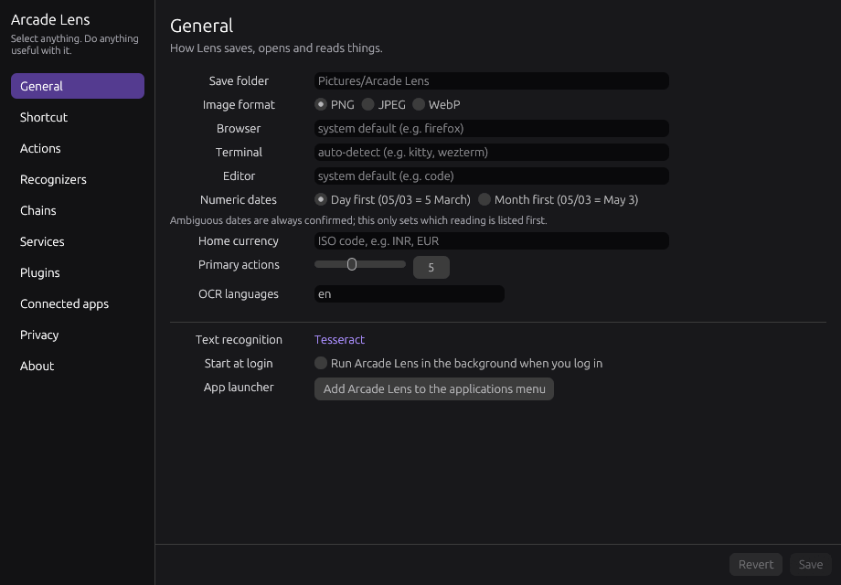

# Arcade Lens

Arcade Lens freezes a view of your screen so you can select a region and act on what is there. It recognizes common visual and text patterns locally and shows useful actions beside the selection.

## Three useful things to start with

- **Read something on screen:** copy text, open a link, or search a file path.
- **Understand a picture or code:** inspect colors, scan a QR code, or decode a barcode.
- **Keep or mark a selection:** save, pin, or annotate it.

Actions can depend on OCR, operating-system support, or other Arcade apps. See [Features](features.md) and [Troubleshooting](troubleshooting.md).
